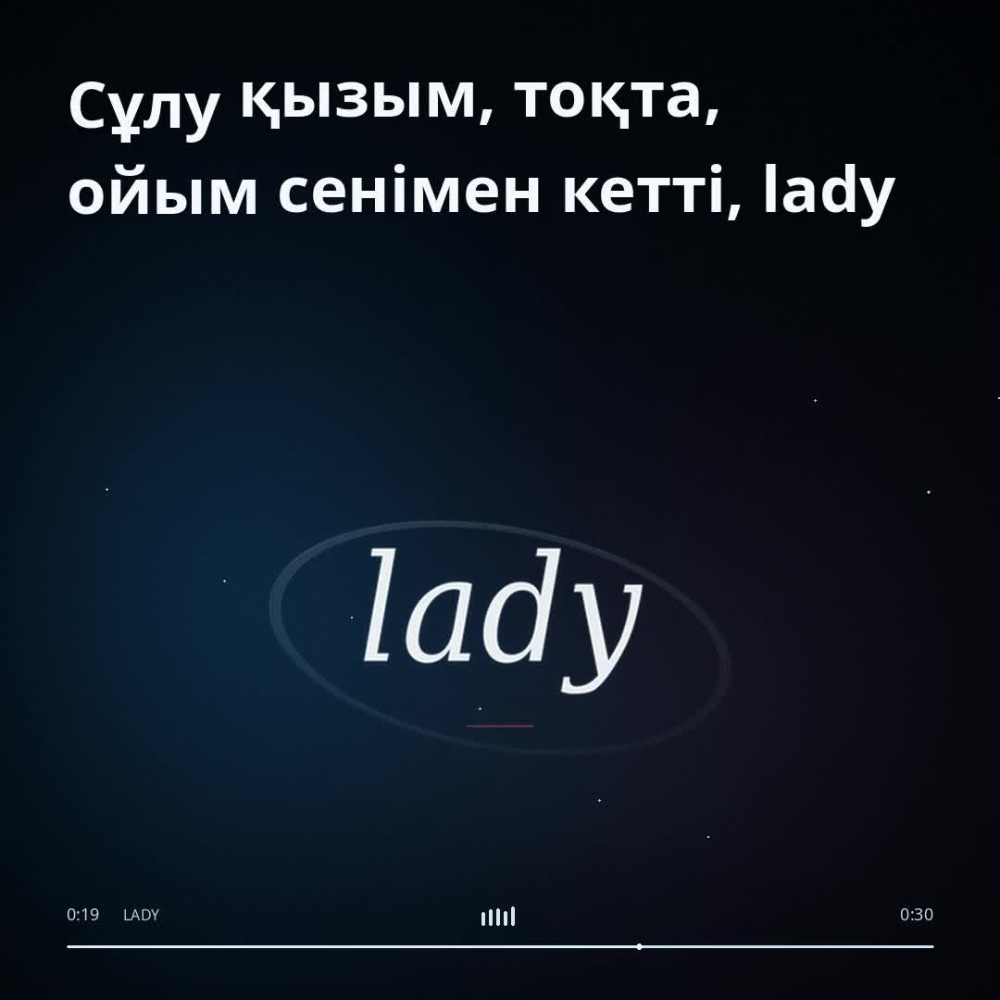
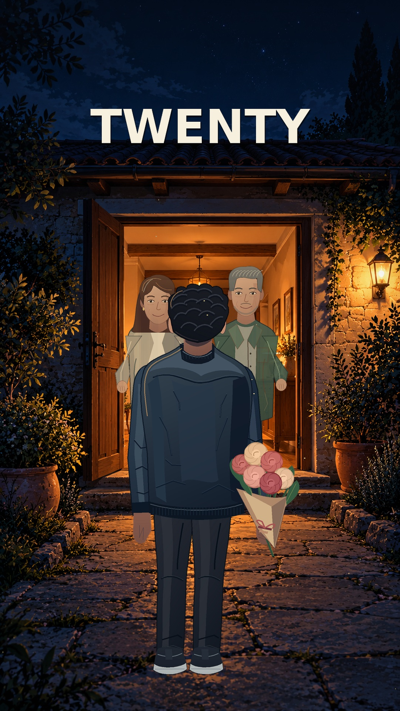
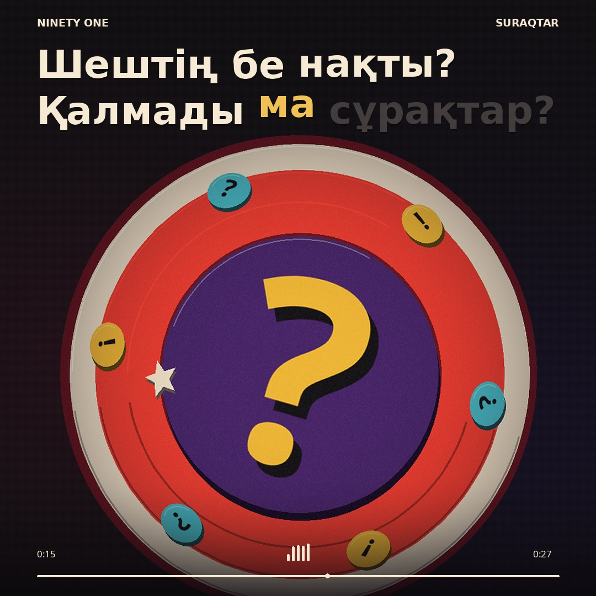

# VideoSongs

## LADY — NINETY ONE · Winter Motion

[Скачать ролик](https://github.com/isnkshwiz/VideoSongs/raw/refs/heads/main/LADY_WINTER_lyric_video.mp4)

Минималистичный motion design: крупная типографика, матовое стекло, холодный свет, геометрические формы и плавные переходы. Казахский текст подсвечивается по вокалу.

- 30 секунд, квадрат 1080 × 1080, 30 кадров/с
- MP4, H.264 / AAC
- Музыка: NINETY ONE — LADY, предоставленный отрывок

## NINETEEN → TWENTY

[Скачать ролик](https://github.com/isnkshwiz/VideoSongs/raw/refs/heads/main/NINETEEN_TO_TWENTY.mp4)

Сюжетный 2.5D-ролик: разрушительный подростковый образ жизни, исчезновение TEEN при переходе NINETEEN → TWENTY, возвращение к семье, учёба и работа. В полночь бутылка превращается в букет, а город — в родительский дом.

- 45 секунд, вертикально 1080 × 1920, 30 кадров/с
- MP4, H.264 / AAC
- Музыка: Crystal Castles — Kerosene (выделенная инструментальная дорожка), NAPA — Deslocado
- Английские надписи и отдельно синтезированный голос возрастов

## SURAQTAR — NINETY ONE

[Скачать видеоролик](https://github.com/isnkshwiz/VideoSongs/raw/refs/heads/main/SURAQTAR_lyric_video.mp4)

Цвета и круглая композиция вдохновлены присланными кадрами: алый, жёлтый, фиолетовый и бирюзовый; объёмная графика и подсветка казахского текста сверху.

- Длительность: 27,6 секунды
- Формат: MP4, H.264 / AAC
- Разрешение: 1080 × 1080, 30 кадров/с

## KETPE — Dasdinlovee

[Скачать видеоролик](../../raw/refs/heads/main/KETPE_lyric_video.mp4)

Лирический ролик по референсу: анимированные карточки, подсветка казахского текста и цветные засветки.

- Длительность: 32,9 секунды
- Формат: MP4, H.264 / AAC
- Разрешение: 1080 × 1080, 30 кадров/с
